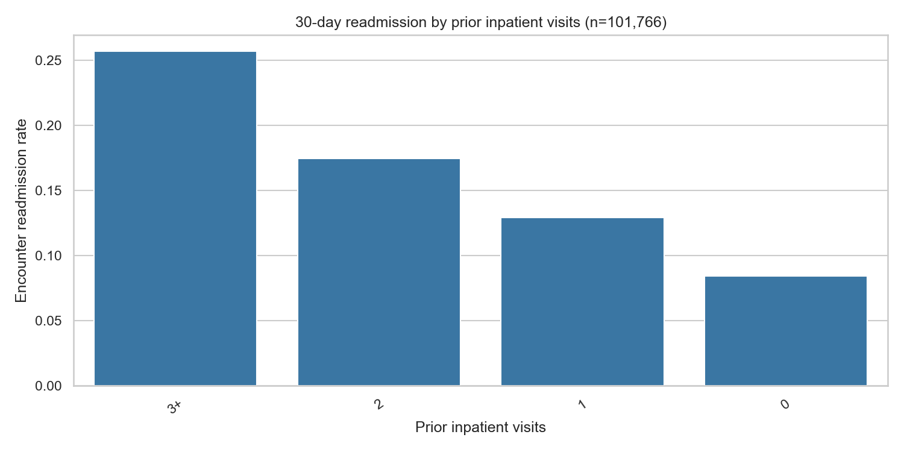
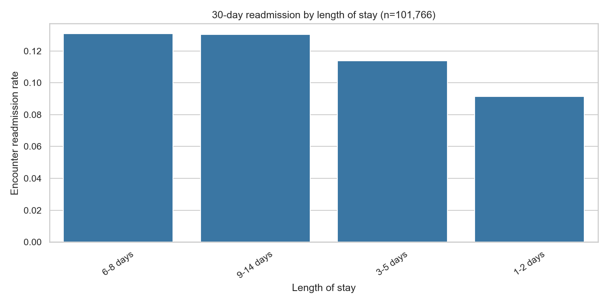
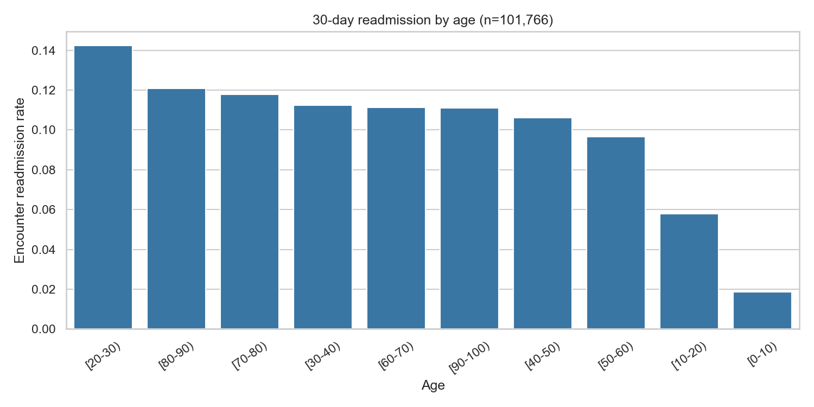

# Diabetes readmission analytics: executive report

## Business question

Among diabetes-related hospital encounters in the UCI historical dataset, what share is followed by an early readmission, which encounter characteristics co-occur with that outcome, and how well can a simple model rank higher-risk encounters?

## Executive summary

The project analyzed **101,766 encounters from 71,518 patients** recorded across 130 US hospitals during 1999–2008. There were **11,357 encounters labeled readmitted within 30 days**, an encounter-level rate of **11.16%**. Repeat inpatient use showed the clearest descriptive gradient: encounters with 3+ prior inpatient visits had a 25.66% early-readmission rate, compared with 8.44% with no prior inpatient visit. Random forest was the strongest of the evaluated models on the patient-grouped holdout (ROC-AUC 0.660, PR-AUC 0.195), but the improvement over the prevalence baseline in PR-AUC is modest and the model is not clinically validated.

These are historical, unadjusted associations. They can guide questions for further analysis, not identify causes or prescribe care.

## Data and method

The UCI archive was downloaded programmatically from the [UCI Machine Learning Repository](https://archive.ics.uci.edu/dataset/296/diabetes%2B130-us+hospitals+for+years+1999-2008). The raw file contains 101,766 rows and 50 columns. There were 71,518 unique patient IDs, no exact duplicate rows, 374,017 missing cells (including the source marker `?`), and no rows with an invalid/missing readmission label among the source records. The cleaned analysis retained all 101,766 target-eligible encounters. `readmit_30d` is 1 for `<30` and 0 for `>30` or `NO`.

Missing predictor values are reported rather than erased from the analysis table. Model imputation (median plus missingness indicators for numeric inputs, most-frequent category for categorical inputs) and one-hot encoding are fitted inside pipelines on training data only. Patient and encounter identifiers and `readmitted` are not model predictors. A fixed-seed 80/20 grouped split assigns all encounters from a patient to only one side. This produced 81,613 train encounters (57,214 patients) and 20,153 test encounters (14,304 patients). Logistic regression and random forest use class weighting. Metrics use a 0.5 classification threshold.

Discharge dispositions 11, 13, 14, 19, 20, and 21, treated here as death/hospice-related, are flagged but retained in the primary cohort. The sensitivity cohort excluding these 2,423 encounters (2.38% of rows) had 99,343 encounters and an early-readmission rate of **11.39%**, versus 11.16% in the primary cohort. Always confirm code mappings for the source version and local context.

## Findings and stakeholder implications

1. **Prior inpatient utilization has the largest observed gradient.** Early readmission was 8.44% among encounters with zero prior inpatient visits (n=67,630), 12.92% with one (n=19,521), 17.43% with two (n=7,566), and 25.66% with three or more (n=7,049). This suggests prior utilization is a useful cohort for follow-up investigation and service planning. It does not establish that prior visits cause a later readmission.

2. **Longer stays were associated with higher encounter-level rates.** Encounters with a 1–2 day stay had a 9.14% rate (n=31,432), compared with 11.37% for 3–5 days (n=41,646), 13.08% for 6–8 days (n=17,789), and 13.03% for 9–14 days (n=10,899). Length of stay may proxy clinical complexity and discharge context; this comparison is not adjusted for severity.

3. **Rates varied by age, but small age bands need caution.** The 80–90 group had a 12.08% rate (n=17,197), compared with 9.67% in the 50–60 group (n=17,256). The 20–30 group was higher at 14.24% (n=1,657); smaller denominators and differences in case mix mean this should be explored with confidence intervals and adjustment before prioritizing an age-specific intervention.

4. **Medication-change status showed a modest unadjusted difference.** The rate was 11.82% among encounters with a medication change (n=47,011) and 10.59% where no change was recorded (n=54,755), a 1.23 percentage-point difference. This is not evidence that changing medications increases readmission; changes may accompany clinical complexity. Medication-specific and timing analyses would be needed.

5. **Broad primary diagnosis groups also varied.** Encounters whose first diagnosis was grouped as diabetes ICD-9 code 250 had a 12.98% rate (n=8,757), versus 11.45% for circulatory diagnoses (n=30,437). These broad bins are derived from the first diagnosis code, so they should be treated as exploratory summaries; diagnosis mix may reflect coding and severity.

## Model results

| Model | ROC-AUC | Precision | Recall | F1 | PR-AUC |
|---|---:|---:|---:|---:|---:|
| Logistic regression | 0.635 | 0.155 | 0.543 | 0.242 | 0.182 |
| Random forest | 0.660 | 0.190 | 0.393 | 0.256 | 0.195 |
| Prevalence baseline | 0.500 | 0.000 | 0.000 | 0.000 | 0.107 |

ROC-AUC measures ranking across thresholds. Precision and recall reflect the fixed 0.5 threshold; recall captures the share of positive encounters flagged, while precision is the share of flags that are positive. F1 balances those two. PR-AUC is useful for the less common positive class; its baseline is close to positive prevalence (10.67% in this test set). At the fixed threshold, logistic regression finds more positives but has lower precision; random forest has slightly stronger ROC-AUC, PR-AUC, and F1. Whether that tradeoff is useful depends on follow-up capacity and a stakeholder-selected threshold. No model here is clinically validated, calibrated for deployment, or externally tested.

## Recommendations for follow-up

- Investigate discharge support and care-transition patterns among encounters with repeated prior inpatient use, while adjusting for severity, hospital, and patient mix.
- Review length-of-stay patterns with admission type, diagnoses, and discharge destination to distinguish complexity from modifiable process factors.
- Examine medication changes at a more detailed level and in relation to discharge prescriptions; the current binary change flag does not indicate which drug changed, why, or when.
- Before using any risk score operationally, perform temporal and hospital-held-out validation, calibration and subgroup performance review, choose a threshold with clinical and operational stakeholders, and evaluate potential harms and benefits.

## Limitations

This is a retrospective educational analysis of historical 1999–2008 records from 130 US hospitals; it does not represent current clinical practice or every hospital. Multiple encounters per patient are present. The grouped split avoids same-patient leakage but does not test future years or unseen hospitals. Missingness can be informative. Results are encounter-level, unadjusted except for modeling, and not causal. The broad ICD-9 grouping is descriptive. The model is a research artifact, not a deployed clinical decision system.

## Figures and artifacts

Charts are in `reports/figures/`; model confusion matrices and metrics are in `reports/model/`. Reproducible details are in `reports/execution_summary.json` and `data/processed/data_quality.json`. Dashboard-ready CSVs are in `dashboard/powerbi_data/`.
